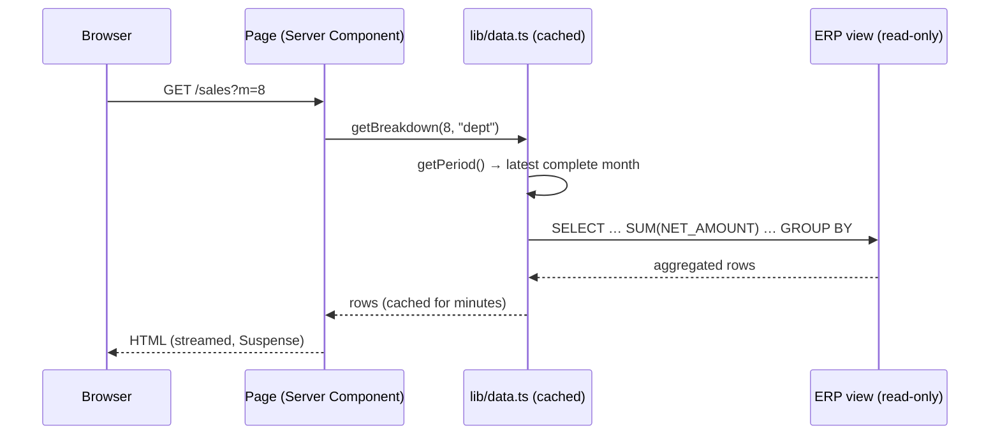
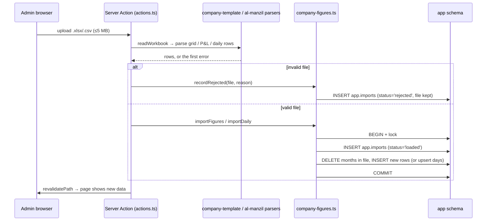
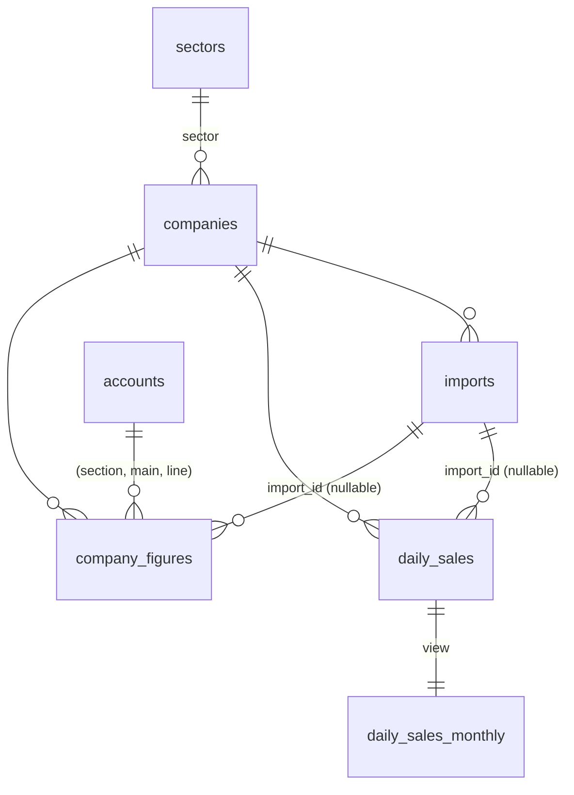
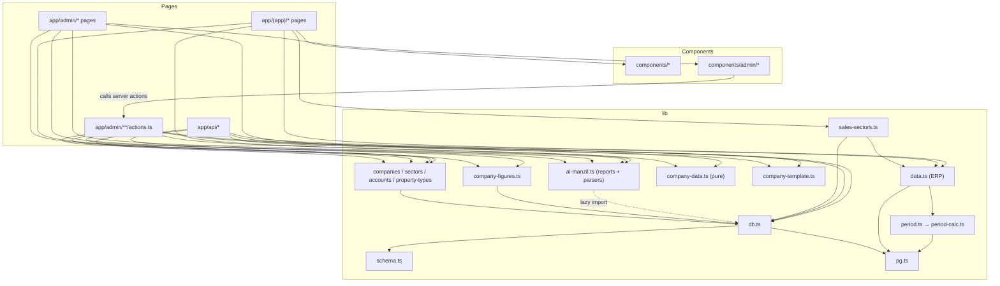

# One Transind — Architecture Review

_Snapshot of branch `feature/company-five-sections`, 2026-11-07. Written for the project owner: plain language first, file references for the developer._

---

## 1. The one-paragraph version

One Transind is a **single Next.js 16 app** that talks to **one PostgreSQL database**. That database holds two very different kinds of data:

1. **ERP sales data** — a read-only view (`SALES_TABLE`, e.g. `public.invs_daily_sales_v`) owned by the ERP. The app only ever runs `SELECT` on it, aggregating invoices into sales charts.
2. **App-owned data** — everything in the `app` schema: companies, sectors, chart of accounts, monthly figures (P&L, balance sheet, budget, people, expenses), hotel daily stay reports, deals, uploads and the activity log. Admins fill this in by uploading Excel/CSV files or typing into grids.

There is no separate backend service: React **Server Components** read the database directly while rendering a page, **Server Actions** handle admin form submits and uploads, and a handful of **Route Handlers** (`app/api/*`) serve JSON, downloads and the OpenAI "Ask" box.

```mermaid
flowchart LR
  subgraph Browser
    U1[Business pages<br/>/dashboard /sales /finance ...]
    U2[Admin pages<br/>/admin/*]
    U3[Ask box]
    U4[Legacy page<br/>/legacy + public/app.js]
  end

  subgraph "Next.js server (one Node process)"
    SC[Server Components<br/>app/(app)/*, app/admin/*]
    SA[Server Actions<br/>app/admin/**/actions.ts]
    API[Route Handlers<br/>app/api/*]
    LIB[lib/ business logic]
  end

  subgraph PostgreSQL
    ERP[(ERP sales view<br/>public.* — READ ONLY)]
    APP[(app schema<br/>app.* tables)]
  end

  OAI[[OpenAI API]]

  U1 --> SC
  U2 --> SC
  U2 -- forms / uploads --> SA
  U3 -- POST /api/ask --> API
  U4 -- fetch /api/bootstrap, /api/deals --> API
  SC --> LIB
  SA --> LIB
  API --> LIB
  LIB -- SELECT only --> ERP
  LIB -- read/write --> APP
  API -- question + data summary --> OAI
```

---

## 2. Main modules

### 2.1 Routes (`app/`)

| Area | Path | What it is |
| --- | --- | --- |
| Root | `app/layout.tsx`, `app/page.tsx` | HTML shell, fonts; `/` redirects to `/dashboard`. |
| **Business app** | `app/(app)/` | The leadership-facing analytics. Shared layout `app/(app)/layout.tsx` draws the left rail (`Shell`), sector toolbar (`SalesToolbar`) and the Ask box (`AskAI`). |
| | `dashboard/` | Group overview: sales cards, sector sales, real-estate summary, drill-down. |
| | `sales/`, `trading/`, `customers/`, `logistics/`, `hr/` | ERP-sales views sliced different ways (dimension, drill-down, top customers, routes/drivers, org chart). |
| | `finance/` | ERP sales vs. cost plus the Al Manzil P&L panel. |
| | `real-estate/overview`, `real-estate/details` | Property P&L, occupancy, average daily rate — computed from app data. |
| | `retail/`, `health-beauty/` | Thin wrappers around `components/SectorSales.tsx`. |
| | `restaurants/` | Static placeholder. |
| **Admin** | `app/admin/` | Data-entry and setup. Own layout with a sidebar listing every company. |
| | `companies/`, `companies/[id]`, `companies/new` | Company registry and the company page with its sections (Profile, P&L, Balance, Budget, People, Expenses). |
| | `finance/`, `al-manzil/actions.ts` | P&L / daily sales / unit-type uploads and inline edits. |
| | `accounts/` | Chart of accounts (P&L lines). |
| | `sectors/`, `company-types/`, `sales-sectors/` | Reference lists; rename/hide ERP departments. |
| | `data-status/` | Which company has submitted which month. |
| | `activity/` | Upload history (`app.imports`) and the job log. |
| **API** | `app/api/` | See §2.4. |
| Legacy | `app/legacy/`, `app/Dashboard.tsx`, `public/app.js`, `public/td.js` | The original framework-free dashboard, loaded as plain scripts. Kept "until every view has a real page". |

### 2.2 Business logic (`lib/`)

Grouped by job:

| Group | Files | Role |
| --- | --- | --- |
| **Database access** | `pg.ts` | The one shared connection pool (max 4 connections), settings from env vars. |
| | `db.ts` | `q` / `q1` query helpers, `numbering()` (transaction + app-wide lock for "next number" logic), first-run init (migrate + seed), deals/log/invoice helpers. |
| | `schema.ts` | The ordered `MIGRATIONS` list and `migrate()`. **The only place the schema changes.** |
| **ERP sales (read-only)** | `data.ts` | All ERP queries: history, overview, customers, breakdowns, drill-downs, routes, salesmen. Results are cached for minutes (`"use cache"`). |
| | `period.ts`, `period-calc.ts` | Decides "this month" = latest complete month in the ERP view (or `SALES_PERIOD`). |
| | `sales-sectors.ts` | ERP departments + admin overrides (rename / hide / map to sector) from `app.sales_departments`. |
| **Company figures** | `company-figures.ts` | Read/write `app.company_figures`, `app.daily_sales`, `app.imports`. Uploads are all-or-nothing transactions. |
| | `al-manzil.ts` | (Name is historical — it now serves every company.) Excel parsers for P&L, daily stay and unit-type workbooks, plus `loadReports()` and readers that compute P&L totals, occupancy and ADR on demand. |
| | `company-data.ts` | Pure rules: section list, grid validation (`parseGrid`), month status (Submitted / Not submitted / Not due). |
| | `company-template.ts` | Builds downloadable Excel templates and reads uploaded `.xlsx`/`.csv` into grids. |
| **Reference data** | `companies.ts`, `sectors.ts`, `accounts.ts`, `property-types.ts` | Small list/get queries. |
| | `org.ts`, `accounts-seed.ts`, `company-input.ts` (`PROPERTY_TYPES`) | Hard-coded seed data used on first init. |
| **Input validation** | `company-input.ts`, `deal-input.ts` | Pure parsers for form/JSON input. |
| **Utilities** | `format.ts`, `url.ts`, `cn.ts`, `tip.ts`, `companies.shared.ts` | Number formatting, URL building, class names, chart tooltips, shared types. |
| **Tests** | `*.test.ts` | `node --test` on the pure files only (period, deal input, company input, company data, template, parsers). |

Design pattern worth knowing: files marked _"Pure (no imports)"_ deliberately avoid the `@/` alias and the database so the built-in Node test runner can load them without Next.js.

### 2.3 Components (`components/`)

- **Business UI** (plain CSS from `app/globals.css`): `ui.tsx` (cards, KPIs, tables), `charts.tsx` (hand-written SVG charts), `Drill.tsx` (server-rendered drill-down tables), `SectorSales.tsx`, `Shell.tsx` (nav), selectors (`MonthSelect`, `YearSelect`, `CompanySelect`, `SalesToolbar`), `AskAI.tsx`, `ChartTip.tsx`.
- **Admin UI** (`components/admin/`, Tailwind + Radix, shadcn-style primitives in `components/admin/ui/`): forms (`CompanyForm`, `AddAccountForm`, …), upload widgets (`UploadReport`, `UploadFigures`), grid editors (`EditPnlFigure`, `FigureSectionView`, `PnlSectionView`), `AdminSidebar`, `Breadcrumbs`, `FinanceCharts`.

Two styling systems coexist: the business pages use the original hand-written CSS; admin uses Tailwind v4 + Radix. `hooks/use-mobile.ts` supports the admin sidebar.

### 2.4 API routes (`app/api/`)

| Route | Method | Used by | Does |
| --- | --- | --- | --- |
| `/api/ask` | POST | `AskAI` | Builds a JSON summary (sales, top customers, Al Manzil P&L/occupancy), sends it with the question to OpenAI, returns the answer. 503 if `OPENAI_API_KEY` is not set. |
| `/api/bootstrap` | GET | legacy `app.js` | Deals, invoices, log. |
| `/api/deals` | POST | legacy `app.js` | Create deal (`D-1001`, …) under the numbering lock. |
| `/api/deals/[id]` | PATCH | legacy `app.js` | Move deal stage; stage 3 creates a local sales-order number (`SO-70001`, …) and logs it. ERP push is a marked shortcut. |
| `/api/sales` | GET | legacy `app.js` | Monthly sales summary. |
| `/api/customers`, `/api/invoices` | GET | legacy `app.js` | Customer and invoice lists. |
| `/api/imports/[id]` | GET | Admin activity log | Download an original uploaded file (forced attachment, safe headers). |
| `/api/companies/[id]/logo` | GET | Admin / pages | Company logo bytes. |
| `/api/companies/[id]/template` | GET | Admin company page | Generates the Excel template for a section/period. |

---

## 3. How data flows

### 3.1 Reading ERP sales (business pages)



- Every query aggregates in SQL (`SUM`, `GROUP BY`) and uses date-range filters so an index on `DOC_DATE` can help.
- `"use cache"` + `cacheLife("minutes")` means repeated page loads within a few minutes do not hit the ERP again.
- Sales value = invoices (`IN`) + credit notes (`CR`, already negative).
- Department names come from `public.invs_departments`, then admin overrides from `app.sales_departments` are applied (`lib/sales-sectors.ts`).

### 3.2 Writing company figures (admin uploads)



Rules enforced here (all match `CLAUDE.md`):
- **All or nothing.** A file is validated in full; nothing is partly loaded.
- **Only the months/days in the file are replaced**; other months stay.
- **Blank ≠ zero.** No row = not submitted; `0` = verified zero.
- **Revenue positive, costs negative, QAR.**
- Every line must exist in `app.accounts` (enforced by a foreign key).
- Every upload attempt keeps the original file in `app.imports`, so it can be downloaded later from the Activity log.
- Hand-typed cells go through `setFigure()` and clear `import_id`, so you can tell typed from uploaded.

### 3.3 Real-estate and P&L reporting

`lib/al-manzil.ts → loadReports()` reads **all** company figures (`pnl`, `sales`, `units`), the `app.daily_sales_monthly` view and the daily rows into an in-memory snapshot. Pages then call synchronous readers (`report`, `occupancy`, `revenueLines`, …) that compute totals, **occupancy %** and **average daily rate** on the fly — never stored, as the project rules require. Monthly hotel sales always come from the daily rows through the view, so the two cannot drift apart.

### 3.4 Ask box

`AskAI` (client) → `POST /api/ask` → builds a compact JSON summary from `lib/data.ts` and `lib/al-manzil.ts` → OpenAI chat completion (20 s timeout) → answer text. Only aggregated figures are sent, not raw invoice rows. The key stays on the server.

### 3.5 Database start-up

`lib/db.ts` runs `migrate()` + seeding lazily on the first query, inside a transaction holding an advisory lock (so two first requests cannot double-seed). In production this only happens when `DB_INIT=true`.

---

## 4. Database map



| Table | Holds |
| --- | --- |
| `app.companies` | Registry: name, sector, ERP code, rooms, room types, property type, logo, hidden/active flags. |
| `app.sectors`, `app.property_types` | Reference lists (seeded). |
| `app.accounts` | Allowed lines per section; `pnl` is admin-editable, the rest fixed by migrations. |
| `app.company_figures` | Every monthly number: (company, section, month, main, line, unit_type) → value. |
| `app.daily_sales` | Hotel daily stay report; check constraint occupied ≤ available. |
| `app.daily_sales_monthly` (view) | Monthly totals from the daily rows. |
| `app.imports` | Every upload attempt with its file, status, error, row count, period. |
| `app.sales_departments` | Admin overrides on ERP departments. |
| `app.deals`, `app.invoices` | Pipeline and invoices for the legacy dashboard. |
| `app.log` | Job log (e.g. "Sales order → ERP"). |
| `app.schema_migrations` | Which migrations ran. |
| `SALES_TABLE` (public) | **ERP, read-only.** Plus `public.invs_departments` for department names. |

Migrations in `lib/schema.ts`: `001_baseline`, `002_standard_data`, `003_drop_report_files`, `005_company_expenses` (there is no `004`; ids are just labels, order is the array order). `scripts/migrate-report-files.ts` is a one-off helper that had to run before `003`.

---

## 5. Dependencies

### 5.1 External packages (`package.json`)

| Package | Why it is here | Where |
| --- | --- | --- |
| `next` 16.4, `react`/`react-dom` 19.3 | Framework. `cacheComponents` and `partialPrefetching` are on in `next.config.ts`. | Everywhere |
| `pg` | PostgreSQL driver. | `lib/pg.ts`, `lib/db.ts`, `scripts/` |
| `exceljs` | Read uploads, build templates. | `lib/al-manzil.ts`, `lib/company-template.ts`, template route |
| `tailwindcss`, `@tailwindcss/postcss`, `postcss` | Styling (admin). | `app/admin/*.css`, admin components |
| `radix-ui` | Accessible primitives (select, switch, sheet, tooltip…). | `components/admin/ui/` |
| `class-variance-authority`, `tailwind-merge` | Variant/class helpers for the admin primitives. | `components/admin/ui/`, `lib/cn.ts` |
| `lucide-react` | Icons. | Admin components |

Dev only: `typescript`, `@types/*`. No test library — tests use Node's built-in runner.

External services: **PostgreSQL** (required), **OpenAI** (optional, `/api/ask` only), **Google Fonts** (stylesheet link in `app/layout.tsx`).

### 5.2 Internal dependency map

Arrows mean "imports".



Observations:
- **Two roads to the database.** ERP reads go straight to the pool (`data.ts → pg.ts`) and skip migration/init; app-schema access goes through `db.ts` (`q`, `numbering`), which guarantees init ran. That separation is intentional and good: ERP pages keep working even before the app schema exists.
- **Admin client components import server actions directly** (`components/admin/* → app/admin/**/actions.ts`). Normal for Next.js; it means `components/admin` depends on `app/admin`, not the other way round only.
- **No circular dependencies** between `lib/` files were found.
- `lib/al-manzil.ts` imports `db.ts` lazily so its parsers stay testable without a database.

---

## 6. Risks and observations

Ordered by how much they matter. Nothing here was changed.

1. **No authentication or access control.** There is no `proxy.ts`/middleware and no login. Anyone who can reach the server on the network can open `/admin`, upload or delete figures, change companies, and call `/api/*` (including `/api/ask`, which spends OpenAI credit). `next.config.ts` also allows dev access from any `192.168.*.*` address. On an internal network this may be an accepted choice, but it should be a conscious one — especially because `.env.local` points at the live database.
2. **Shared in-memory report snapshot.** `loadReports()` in `lib/al-manzil.ts` stores one module-level `snap` for the whole server. Two requests running at once both reload it; since they load the same data this is normally harmless, but it reloads _every_ company's figures on every request that uses it, which will get slower as data grows.
3. **Al Manzil found by name.** The Al Manzil panels (`/finance`, `/admin/finance`, Ask) pick the company with `lower(name) LIKE 'al manzil%'`. Renaming that company silently empties those panels. Already marked as a `shortcut:` in code.
4. **Legacy dashboard still live.** `/legacy` + `public/app.js` + the deals/invoices/bootstrap/sales/customers APIs exist only for the old page. Once its views are rebuilt, this is a sizeable chunk that can be removed.
5. **Two UI systems.** Business pages use hand-written CSS; admin uses Tailwind + Radix. Fine today, but new shared components need to pick one.
6. **Small connection pool (max 4).** Fine for a handful of internal users; heavy dashboard pages run several queries in parallel, so watch for slow pages under load.
7. **Test coverage is limited to pure helpers.** Database code (`company-figures.ts`, `data.ts`, migrations) has no automated test — changes there rely on manual checking against the live DB.
8. **Naming drift.** `lib/al-manzil.ts` now serves every company; `MONTHS` is defined twice (`al-manzil.ts`, `company-data.ts`). Cosmetic.

---

## 7. Quick orientation for a new developer

- Want to change **what a sales chart shows**? → `lib/data.ts` + the page under `app/(app)/`.
- Want to change **what an upload accepts**? → parsers in `lib/al-manzil.ts` / `lib/company-data.ts` (`parseGrid`), save logic in `lib/company-figures.ts`, form in `app/admin/**/actions.ts`. Add a test in the matching `*.test.ts`.
- Want a **new table or column**? → append a new entry to `MIGRATIONS` in `lib/schema.ts`. Never edit an old one.
- Want a **new admin page**? → `app/admin/<name>/page.tsx` wrapped in `components/admin/Page.tsx`, link it in `components/admin/AdminSidebar.tsx`.
- Settings live in `.env.local` (see `README.md`). Never in code.
